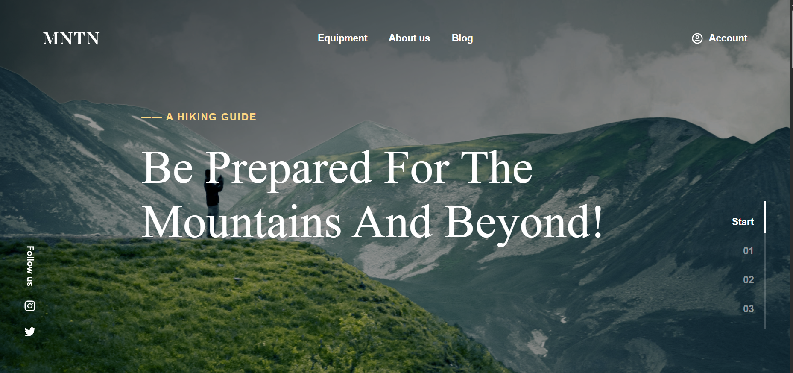

# Hi there, I'm Konstantina! ✨

### 🎀 Junior Frontend Developer • Figma-to-Code Specialist

**Turning creativity into fast, responsive, and pixel-perfect web experiences**  
_BSc in Computer Science • 1 Year Remote Agency Experience • Open to Junior & Remote Roles_

 

---

### 🌸 Quick Highlights for Teams & Recruiters

-  **Figma to Pixel-Perfect Code:** Specialized in translating Figma design files into clean, accessible code with **HTML5, modular SCSS, CSS Grid, and Flexbox**.
-  **1 Year Agency Tested:** Remote agency experience at **Threenitas** delivering landing pages and interactive components for brands like **Kägi** and **Fischer**.
-  **Performance & Quality:** Focused on high Google Lighthouse scores, semantic HTML, cross-browser consistency, and clean git commits.

---

### 🎀 Tech Stack & Toolkit

---

### ✨ Featured Projects

<table>
<tr>
<td width="50%" valign="top">
<h3 align="center">🍳 Cooks Delight — Recipe Discovery</h3>

A responsive food discovery platform featuring dynamic client-side URL routing (<code>?id=...</code>) to asynchronously render individual recipes, interactive Swiper.js touch carousel, dietary/category filters, and an interactive ingredients checklist.

<b>Tech:</b> <code>HTML5</code> • <code>SCSS</code> • <code>Vanilla JS (ES6+)</code> • <code>Swiper.js</code> • <code>JSON Data</code>

</td>
<td width="50%" valign="top">
<h3 align="center">⛰️ MNTN — A Hiking Guide Landing Page</h3>

An immersive mountain and hiking guide landing page translating complex Figma designs into responsive code. Features elegant typography, clean section navigation, fluid responsive cards, and outdoor-inspired UI aesthetics.

<b>Tech:</b> <code>HTML5</code> • <code>SCSS / CSS3</code> • <code>Responsive Design</code> • <code>Figma to Code</code>

</td>
</tr>
</table>

---
